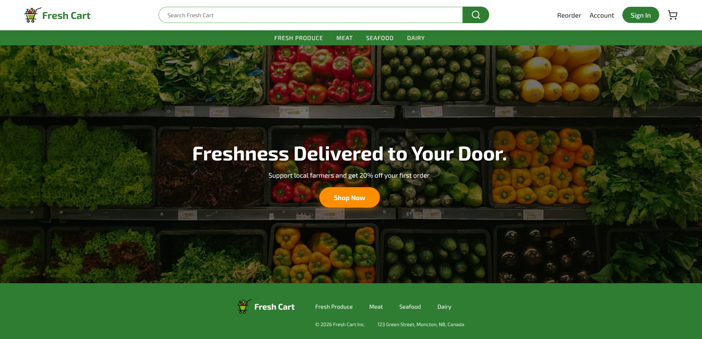
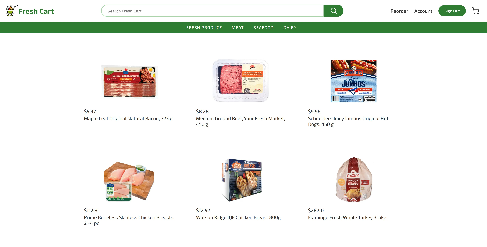
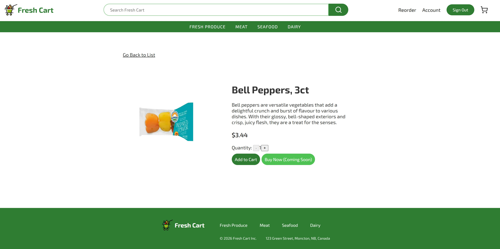
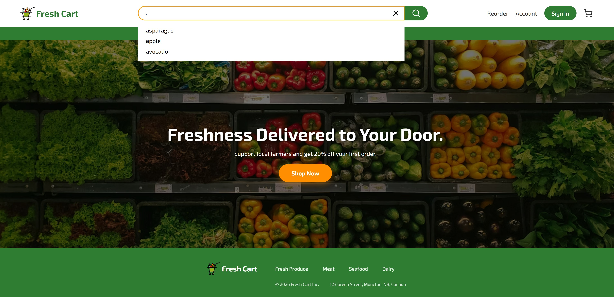
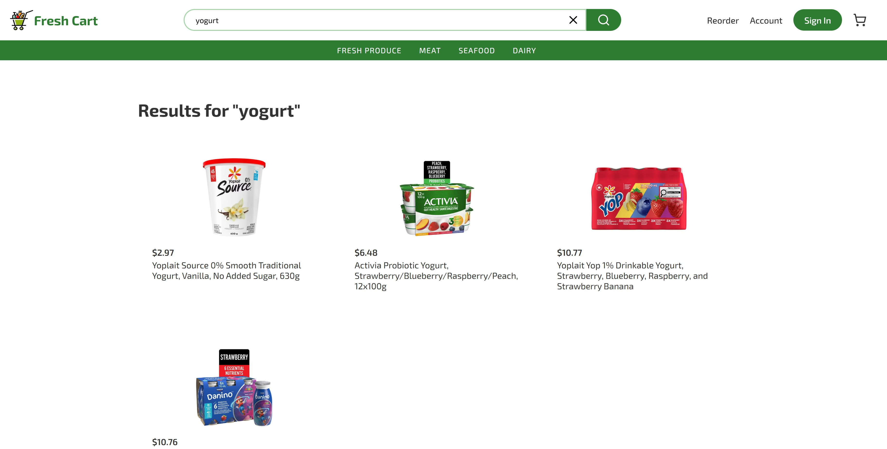
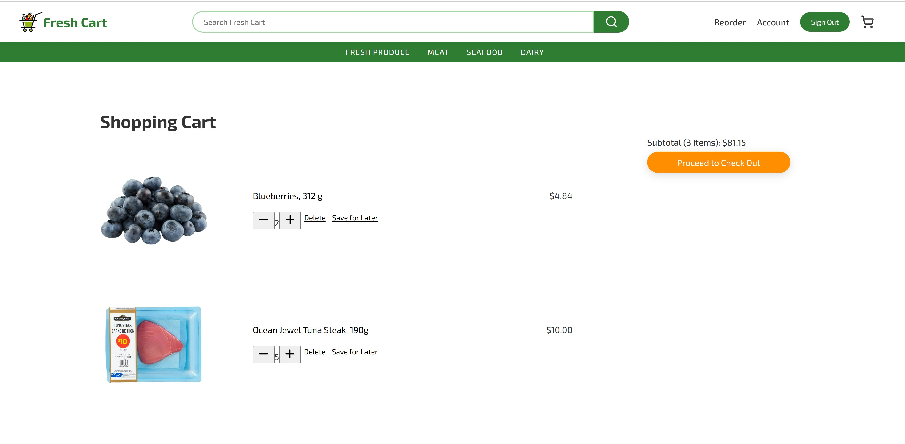
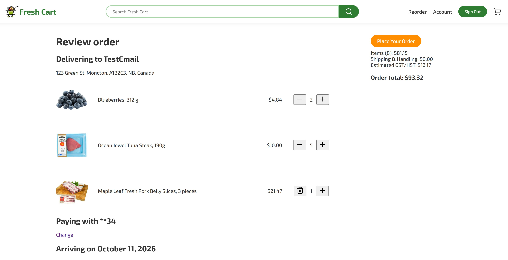

# Fresh Cart v2

A full-stack grocery e-commerce web application built with TypeScript, React, Next.js, and MySQL.

---

## 📺 Live Demo

[Fresh Cart](https://fresh-cart-v2-eta.vercel.app/)

---

## 🎯 Why I Started This Project

I developed a strong foundation in web development through coursework, academic projects, and small personal projects.

However, I wanted to build my own web application end-to-end to deepen my understanding of full-stack development and gain hands-on experience in everything from relational database design and REST API development to automated testing and cloud deployment.

This project builds on Fresh Cart v1, which was originally developed using JavaScript and Express.js. I refactored the application using TypeScript and Next.js to improve type safety and consolidate the frontend and backend within a single framework.

---

## 🛠 Tech Stack

- Frontend: TypeScript, React, Next.js
- Backend: Next.js Route Handlers (REST APIs)
- Database: MySQL
- Testing: Jest, React Testing Library
- Deployment: Vercel (Public Demo), Railway, AWS EC2, Nginx (Reverse Proxy)
- Containerization: Docker, Docker Compose
- Version Control: Git, GitHub

---

## 🪏 Development Phases

### Phase 1: Initial Development (June–August 2026)

#### Key Implementations:

- Developed a RESTful API with 11 endpoints for authentication, product browsing, product search, shopping cart, and checkout.
- Implemented secure user authentication using JWT.
- Implemented guest cart merging after a successful sign-in.
- Wrote unit and component tests using Jest and React Testing Library.
- Deployed the application to AWS EC2 using Docker, Docker Compose, and Nginx.

---

### Phase 2: Homepage Redesign (Oct 2026)

#### Key Improvements:

- Redesigned the hero section to improve visual hierarchy.
- Reorganized the header and footer to improve spacing and alignment.
- Standardized icons using Lucide to improve visual consistency.

---

### Phase 3: Backend Architecture Refactoring (Oct 2026–Present)

- Goal: Analyze the current backend architecture and refactor it into a clean monolith by applying Clean Architecture principles to improve separation of concerns, maintainability, and testability.
- Status: In Progress

---

## 📸 Screenshots

### Homepage



### Product List



### Product Detail



### Search & Search Results





### Cart



### Checkout



---

## 📈 Major Challenges & Solutions

### Preserving Guest Cart Items

**Problem:**
Guest cart items are lost when users sign in because guest and authenticated carts are managed separately.

**Solution:**
Store guest cart items in localStorage and merge them with the user’s cart after sign-in, allowing users to continue shopping seamlessly.

---

### Preventing Open Redirects

**Problem:**
Using unvalidated redirect URLs can expose users to phishing attacks and credential theft.

**Solution:**
Implement a redirect map and allow navigation only to predefined routes.

---

### Handling Failed Order Requests

**Problem:**
The "Placing Order..." button remains disabled when order creation fails, preventing users from retrying the checkout process.

**Solution:**
Add a finally block and reset the submitting state so that users can retry the checkout process after a failed order request.

---

## 🔮 Future Improvements

- Redesign the Account Dashboard with a card-based layout
- Implement an Order Details page
- Add Reorder, Payment Processing, and Buy Now functionality

---

## 📦 Installation / Setup

### Local Development

1. Clone the repository.

```bash
git clone https://github.com/chloejo-dev/fresh-cart-v2.git
```

2. Navigate to the project directory.

```bash
cd fresh-cart-v2
```

3. Install dependencies.

```bash
npm install
```

4. Create a `.env.local` file and add the required environment variables.

```env
DB_HOST=
DB_PORT=
DB_USER=
DB_PASSWORD=
DB_NAME=
JWT_SECRET=
```

5. Start the development server.

```bash
npm run dev
```

6. Open your browser and visit:

```text
http://localhost:3000
```

---

### Run with Docker

Run the application using Docker Compose.

```bash
docker compose up --build
```

---

## 👤 Author

- Chloe Jo
- GitHub: [chloejo-dev](https://github.com/chloejo-dev)
